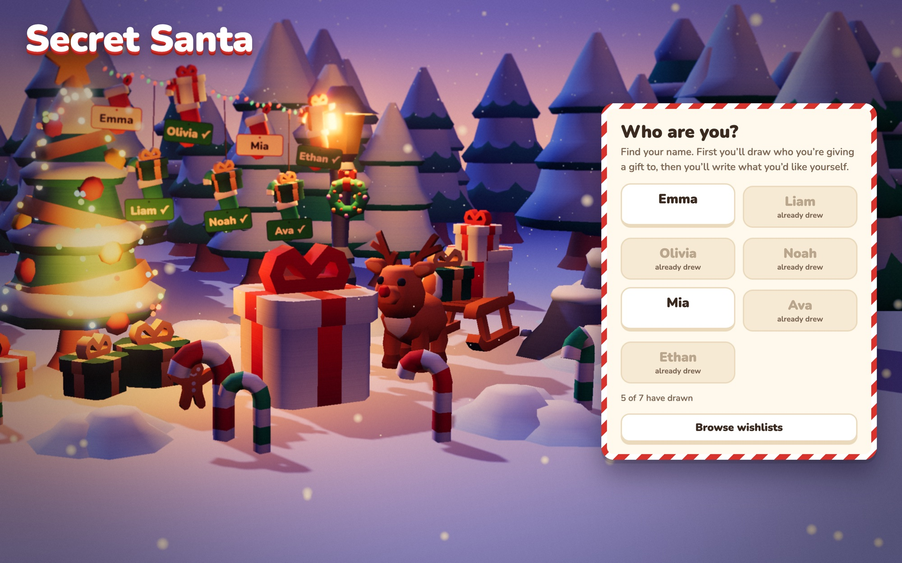
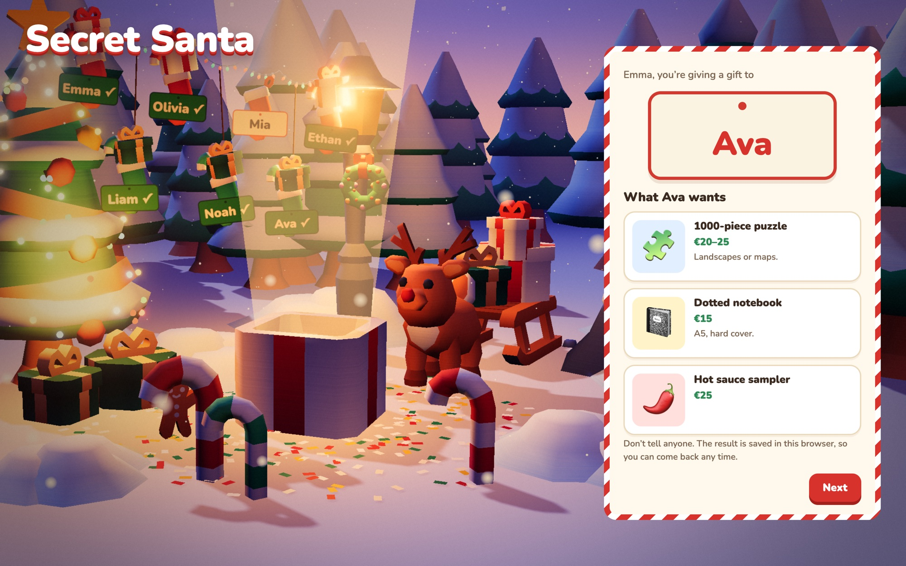
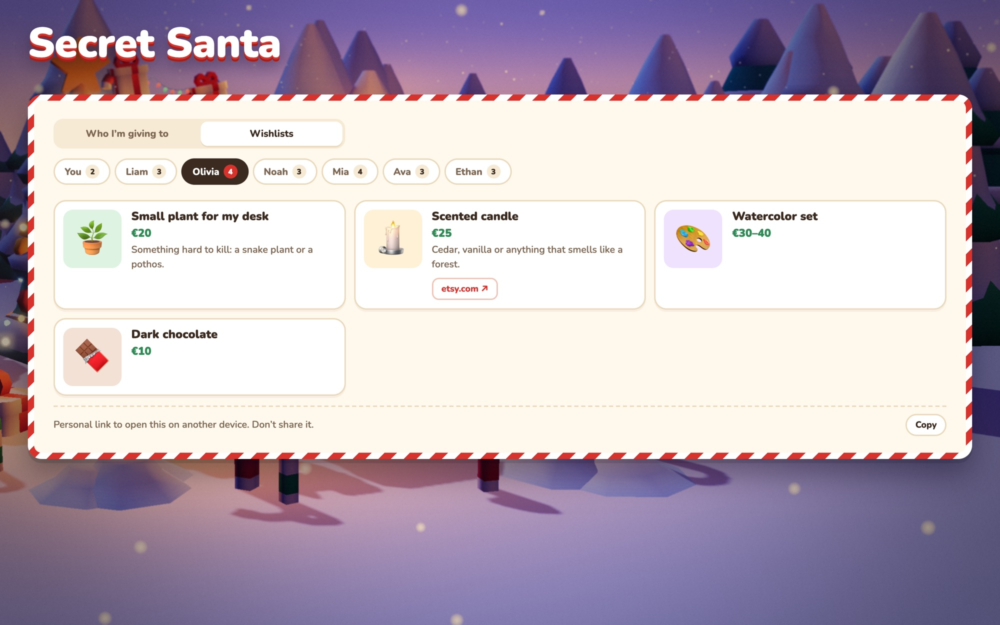
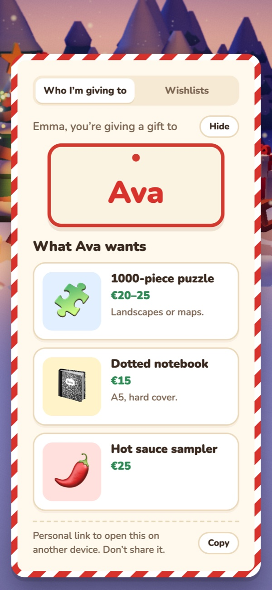

# Secret Santa

A small website for running a Secret Santa draw among friends: find your name, draw who you're giving a gift to, then fill in your own wishlist. It comes with a 3D scene where the name pops out of a gift box.



<table>
  <tr>
    <td width="50%"></td>
    <td width="50%"></td>
  </tr>
  <tr>
    <td align="center">The name pops out of the gift</td>
    <td align="center">Who you're giving to and what they want</td>
  </tr>
</table>

<table>
  <tr>
    <td width="72%"></td>
    <td width="28%"></td>
  </tr>
  <tr>
    <td align="center">Everyone's wishlists: price, description, link and photo</td>
    <td align="center">Works on phones</td>
  </tr>
</table>

- Nobody can see who gives to whom, not even the admin: each pair is encrypted with the participant's personal token, and that token lives only in their browser.
- Wishlists are public, so you can browse them without taking part.
- English and Russian interface.
- Stack: Node.js, Express, SQLite, React, three.js.

## Quick start with Docker

```bash
cp .env.example .env    # list the participants and pick the language
docker compose up -d --build
```

Open http://localhost:3000. The database is kept in the `santa-data` volume, so it survives restarts and rebuilds.

After changing `.env`, apply it with `docker compose up -d`.

## Configuration (`.env`)

| Variable | Description |
|---|---|
| `NAMES` | Participants, comma-separated. Required: `NAMES=Anna,Bob,Vika` |
| `LOCALE` | Interface language: `en` (default) or `ru` |
| `ADMIN_KEY` | Key for resetting the draw. Leave empty to disable reset |
| `PORT` | Port, defaults to `3000` |
| `DB_PATH` | Database file, defaults to `santa.db` (`/data/santa.db` in Docker) |

**Changing participants.** Edit `NAMES` and restart. Before anyone has drawn, the database updates itself. Once the draw has started, the list stays as it is; to change it, reset the draw:

```bash
curl -X POST http://localhost:3000/api/admin/reset -H "x-admin-key: <ADMIN_KEY>"
```

A reset deletes all pairs and wishlists.

## Running without Docker

Requires Node.js 20+.

```bash
npm install
cp .env.example .env
npm run build
npm start               # http://localhost:3000
```

For development, run `npm run dev:server` and `npm run dev` in two terminals, then open http://localhost:5173.

## Translations

All interface text lives in [web/src/locales.js](web/src/locales.js). To add a language, copy the `en` block under a new code and set `LOCALE` to it.

---

3D models: [Kenney Holiday Kit](https://kenney.nl/assets/holiday-kit) (CC0).
